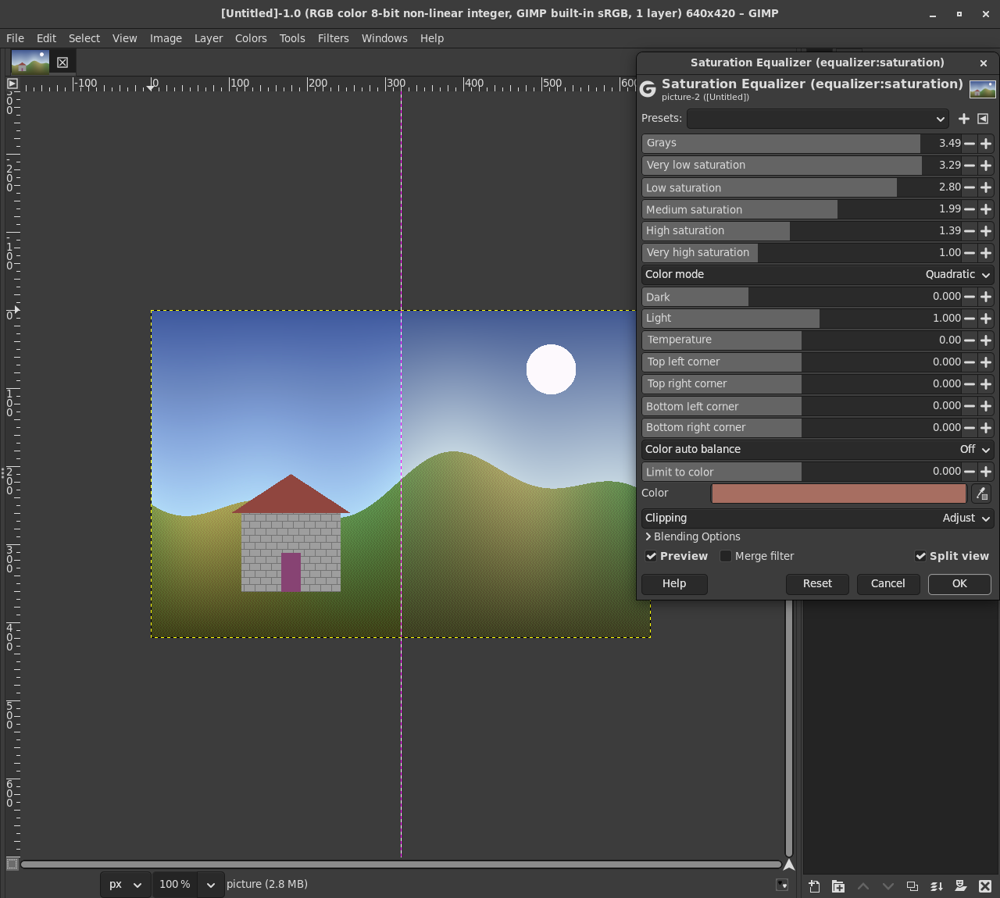
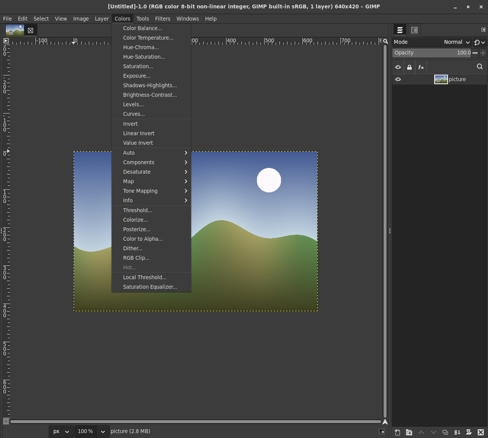
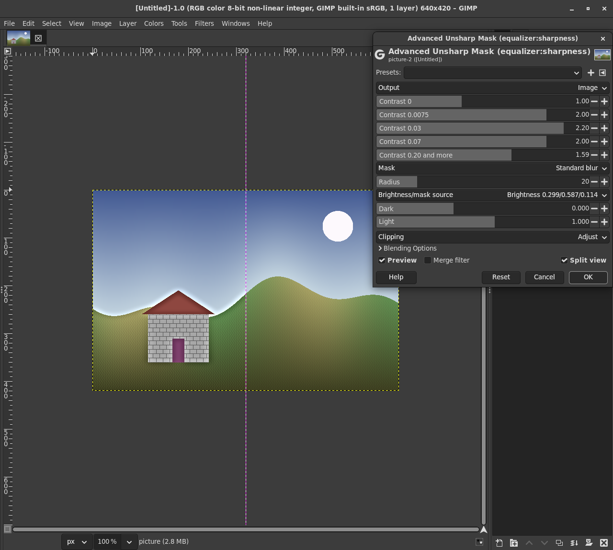
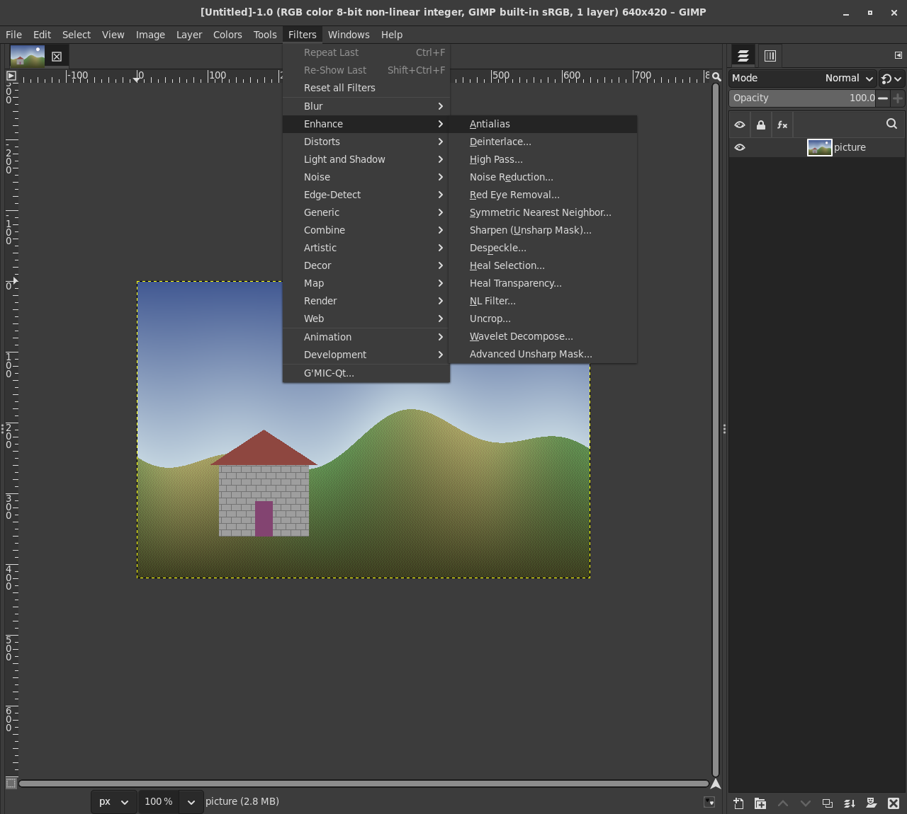
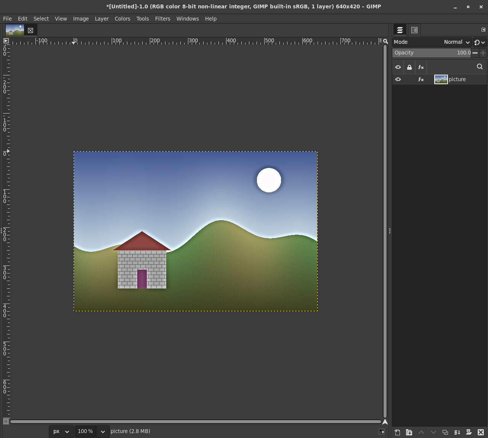

# gegl-equalizers

Tibor Bamhor's two GIMP 2 plug-ins, **Saturation Equalizer** and
**Advanced Unsharp Mask** (AUMASK), as GEGL operations for GIMP 3. Both
are non-destructive filters: live preview, GIMP's split view, editable
later in the layer's effects, kept in XCF files, on images of any
precision.

- **Saturation Equalizer** (`equalizer:saturation`, **Colors >
  Saturation Equalizer**): changes saturation by each pixel's own
  saturation, with six bands like an equalizer, so that dull colors can
  gain much and strong colors little or nothing. Five color modes,
  levels, per-corner brightness, temperature, color auto balance, and a
  limit to the colors near (or away from) a picked color.
- **Advanced Unsharp Mask** (`equalizer:sharpness`, **Filters > Enhance >
  Advanced Unsharp Mask**): sharpens by the difference between each
  pixel's brightness and a blurred mask, with a factor for each size of
  that difference (fine texture, detail, edges), standard or selective
  blur, six brightness sources, levels through the mask, and the mask or
  the difference as output.

The name: both originals are equalizers (the Saturation Equalizer's six
bands; AUMASK's "Sharpness equalizer" sliders), and the repository has
GEGL operations only, hence `gegl-equalizers` by the house rule
(`gegl-<name>` for GEGL-only repositories).

## Why

From gimp-devtools/docs/candidates.md (item 4) and
prior-art-candidates.md (checked 2026-09-26 and 27): neither plug-in has
a GIMP 3 port; GIMP 3.2 has no saturation-by-saturation curve (its
Vibrance is a fixed curve); G'MIC's "Saturation EQ" is a different filter
(saturation by lightness and hue, not by saturation, 8 bit HSL, no
temperature or balance); AUMASK is partly covered by G'MIC's "Sharpen
[Multiscale]" and LinuxBeaver's "Sharpen Deluxe", neither with its
equalizer or selective mask, and G'MIC is always destructive. The
registry.gimp.org mirror counts 70 comments for the Saturation Equalizer
(7th of all) and 60 for AUMASK.

## Using them in GIMP

Every option of the originals that changes pixels is here with the same
range and default; docs/originals.md describes each option of the
originals as their code has it.

### Saturation Equalizer

- **Grays** to **Very high saturation**: the six bands, factors for the
  saturation at 0, 0.11, 0.21, 0.43, 0.71 and 1.43 times the color mode's
  typical saturation (Quadratic 0.07, Safe Quadratic 0.09, HSV 0.24, HSL
  0.55, YUV 0.17), interpolated in between; 1 leaves a band as it is.
  (The originals' sliders had no labels.)
- **Color mode**: Quadratic (the plug-in's own brightness,
  sqrt (0.241 R^2 + 0.691 G^2 + 0.068 B^2)), Safe Quadratic (kept within
  0 to 1 where possible), HSV, HSL, YUV.
- **Dark**, **Light**: like Levels on the brightness.
- **Temperature**: warmer to the right, at the same brightness.
- **Top left corner** and the other three: brightness added per corner,
  fading across the layer.
- **Color auto balance**: Off, **Whole layer** (the average of the layer
  should be neutral) or **Picked color** (a color that should be neutral,
  e.g. snow; pick it from the image, with the tool options' sample
  average for an area), and its **Weight**.
- **Limit to color** and **Color**: right of 0 only colors near the
  color change (fading out up to twice the range); left of 0 the colors
  near it are kept and the others change.

### Advanced Unsharp Mask

- **Output**: the image, the mask, or the difference between them.
- **Contrast 0** to **Contrast 0.20 and more**: the factor for the
  difference between a pixel's brightness and the mask at 0, 0.0075,
  0.03, 0.07 and 0.20 (brightness from 0 to 1), interpolated; above 1
  sharpens, below 1 softens, 1 keeps. Raise the middle ones and keep
  **Contrast 0** at 1 to sharpen detail without sharpening noise.
- **Mask**: Standard blur, Selective blur (only similar brightness is
  blurred together, **Threshold**), or Selective with postblur
  (**Postblur radius**); **Radius** 1 to 500 pixels.
- **Brightness/mask source**: 0.299 R + 0.587 G + 0.114 B (default),
  HSV value, HSL lightness, or "R/G/B to brightness" (the channel's
  sharpened value becomes the pixel's brightness, which changes colors
  even at 1).
- **Dark**, **Light**: levels through the mask, which keeps local
  contrast.
- **Central brightness**, **Difference boost**: for the difference
  output.

Applied with OK the filter stays live in the layer's effects (the fx
badge) and in the XCF:

## Changes from the plug-ins

Only where the originals were 8 bit or had bugs. Each bug fix is also a
patch to the original code (tests/orig/aumask-fixes.patch and
sateq-fixes.patch, marked FIX n), and the operations are compared with
the original code both with and without them (Tests, below).

Both:

- Float in and out: no 8 bit rounding, and values below 0 and above 1
  are kept (the plug-ins clipped them at their 8 bit output). For values
  below 0, pow keeps the sign.
- NaN is taken as 0 and values beyond +-1e6 are limited, so nothing
  that is not a number reaches the arithmetic or the neighbours; a pixel
  whose arithmetic still fails keeps its value. Alpha is passed on bit
  for bit.
- The layer is the domain: the per-corner brightness and the whole
  layer balance refer to the layer, AUMASK's blur leaves out points
  outside the layer (the plug-ins used the selection's bounding box and
  did not look beyond it); GIMP's selection masks the result as usual.
- Not ported, because GIMP 3 does them for every filter: the previews,
  AUMASK's Split output (GIMP's split view), "Export as new layer", Reset.
  Not ported because they only moved the dialog's sliders: the slider
  coupling; also the Saturation Equalizer's preview statistics.

Saturation Equalizer:

- Limit to color: each color mode's own distance (the plug-in's chain of
  ifs gave Quadratic and HSL the YUV distance), hue distances round the
  circle, the picked color's hue from the same pow (1 / 2.2) values as
  the pixels', and the inverted range (left of 0) works (in the plug-in it
  changed nothing, or used left-over values).
- Safe Quadratic moves R, G and B by the same amount (the plug-in took a
  new minimum after each channel).
- Color auto balance: from the whole layer, all pixels, in double
  precision, or from a picked color (the plug-in: every second pixel of
  the preview, in float, from whatever the preview was zoomed to).
- The default limit color is #a76e61, the nearest 8 bit color to the
  plug-in's 16 bit 43010, 28305, 24990 (within half a level of 255).

Advanced Unsharp Mask:

- **Contrast 0.20 and more** is a slider. In the plug-in the factor went
  from a hidden fifth value at 0.20 (which followed the fourth slider,
  depending on the dialog's history) down to 0 at a difference of 1.1,
  read from past the end of an array: at its defaults the plug-in
  softened strong edges, by up to 63 levels in the tests. Here the
  defaults leave the image as it is. To come close to the plug-in, set
  the fifth slider to the fourth clamped to 1 +- 0.3.
- HSV and HSL sources: V or L at most the pixel's own when that is above
  1 (the plug-in clipped to 1; the same at 8 bits).

## Color spaces

The originals worked on GIMP 2's 8 bit values, which are the image's
encoded values (sRGB's curve for sRGB), and raised them to 1 / 2.2 once
more. The operations do the same on R'G'B' float of the image's own
color space: identical on 8 bit sRGB images, the same numbers for the
same encoded values in another space (checked with ProPhoto); for
linear images GEGL hands the operation their encoded values. The weights
(0.299, 0.587, 0.114; 0.241, 0.691, 0.068) are the originals'.

## Building and installing

With the Flatpak GIMP, and ../gimp-devtools (github.com/sandbranch/gimp-devtools):

    ../gimp-devtools/gimp-build.sh . meson setup build -Dmoduledir=\$GEGL_OPDIR
    ../gimp-devtools/gimp-build.sh . ninja -C build install

That installs `saturation-equalizer.so` and `advanced-unsharp-mask.so`
into `~/.var/app/org.gimp.GIMP/data/gegl-0.4/plug-ins`. Natively, with
GEGL 0.4.62 or later: `meson setup build -Dmoduledir=~/.local/share/gegl-0.4/plug-ins`
and `ninja -C build install`. Restart GIMP.

## Tests

All run inside the Flatpak GIMP's SDK (or natively with
GIMP_FLATPAK=0), with HOME and the XDG folders in tests/output and a
throwaway GIMP profile, and list the user's folders of GIMP and other
apps before and after (tests/isolate.sh, a copy of
gimp-devtools/isolate.sh): each fails if anything there changed.

- **tests/orig-check.sh**: against the originals' own code. It downloads
  aumask-0.9.2.tgz and satequalizer-0.9.1.tgz from the Google Code
  archive and GIMP 2.10.38's gimpcolorspace.c, checks SHA-1 and SHA-256,
  takes the computing part out of the plug-ins (tests/orig/extract.py:
  only the dialog, its callbacks, query and run are dropped, the rest
  byte for byte), builds it with a fake libgimp (tests/orig/fake-gimp.h)
  as it is and with the fix patches, and runs 71 cases on generated 8
  bit images (colors of every hue and saturation, hard edges and texture,
  a photo-like image with a color cast; RGB and RGBA). Result: every
  pixel of every case within 1 level of the original with the fixes;
  over all 1,744,896 pixels 99.987 % identical and 0.013 % 1 level off
  (float against the plug-in's double just before rounding). Against the
  original as it is 96.0 % are identical; at the pixels where the fixes
  change nothing, the operation differs from the original at 220 of the
  1,744,896, by 1 level.
- **tests/check.sh**: 83 numerical checks, also under AddressSanitizer
  and UndefinedBehaviorSanitizer (no errors, no leaks in our code, no
  leaked GeglBuffers): identity at the neutral settings (passed on bit
  for bit, and through the arithmetic within 2e-6; YUV within 5e-4, the
  original's three digit matrix), grays stay gray, bands, levels,
  corners, temperature, balance, the limit, the mask, amounts, selective
  blur, reach; the same bits in 53 x 37 pieces, with 1 or 24 threads and
  for a moved layer; NaN, infinities, 1e30, extremes of every setting,
  1 x 1 layers; 8 and 16 bit, half, double, linear and gray buffers,
  another color space; the menu keys.
- **tests/gimp-check.sh**: in headless GIMP 3.2.6, both filters as
  Gimp.DrawableFilter on RGB images of every precision and on
  grayscale: non-destructive, settings kept through an XCF save and
  load, the same pixels as plain GEGL (max difference 0) and as the gegl
  command line (0). (The gegl command line counts one leaked buffer at
  its exit for the saturation cases, as it does for GEGL's own
  gegl:unsharp-mask; the script notes it.)
- **tests/gui/shots.sh**: the menus and dialogs in GIMP on a Broadway
  display, driven by a headless Chrome, for the screenshots here, and a
  filter applied with OK, saved, and live after loading the XCF.
- **tests/bench.sh**: speed, below.

## Speed

6000 x 4000 pixels (24 megapixels), tests/bench.sh, 24 threads, float:

| | float | 8 bit | 1 thread, float |
|---|---|---|---|
| gegl:saturation (GEGL's, for scale) | 0.18 s | 0.18 s | 0.33 s |
| gegl:unsharp-mask, 20 px (GEGL's) | 0.53 s | 0.53 s | 1.8 s |
| Saturation Equalizer, Quadratic | 0.34 s | 0.46 s | 5.7 s |
| Saturation Equalizer, HSV | 0.20 s | 0.35 s | 2.5 s |
| Saturation Equalizer, temperature, limit, corner | 0.62 s | 0.59 s | 8.0 s |
| Saturation Equalizer, balance of the whole layer | 0.46 s | 0.57 s | 6.7 s |
| Advanced Unsharp Mask, radius 5 | 0.48 s | 0.74 s | 3.0 s |
| Advanced Unsharp Mask, radius 20 | 0.55 s | 0.79 s | 3.8 s |
| Advanced Unsharp Mask, radius 20, postblur | 0.65 s | 0.91 s | 4.8 s |
| Advanced Unsharp Mask, radius 100 | 0.96 s | 1.6 s | 6.6 s |
| Advanced Unsharp Mask, radius 500 | 1.7 s | 1.9 s | 16.6 s |
| either at its neutral settings (passed on) | 0.001 s | 0.001 s | 0.02 s |

The Saturation Equalizer's time is mostly pow (1 / 2.2) and pow (2.2)
per channel, as in the original; a large AUMASK radius costs its margin
in each of GEGL's chunks (PLAN.md).

## Credits and licences

- The algorithms and the original code: **Tibor Bamhor** (tibor95),
  Saturation Equalizer 0.9.1/0.9.2 (2011 to 2016) and Advanced Unsharp
  Mask 0.9.2 (2011 to 2013), GPL 3 (docs/originals.md has where each
  licence statement is).
- operations/equalizer-common.h has GIMP 2.10.38's HSV and HSL
  conversions (libgimpcolor/gimpcolorspace.c, Peter Mattis and Spencer
  Kimball, LGPL-3.0-or-later), which the originals call.
- The port, tests and documentation: David, 2026.

The operations are derived from the plug-ins, whose licence names
version 3 only, so they and the repository are **GPL-3.0-only**
(COPYING). The test scripts and harnesses that are new work say
GPL-3.0-or-later in their headers; tests/isolate.sh is gimp-devtools'
(GPL-3.0-or-later). The original sources are not in the repository;
tests/orig-check.sh downloads them.
